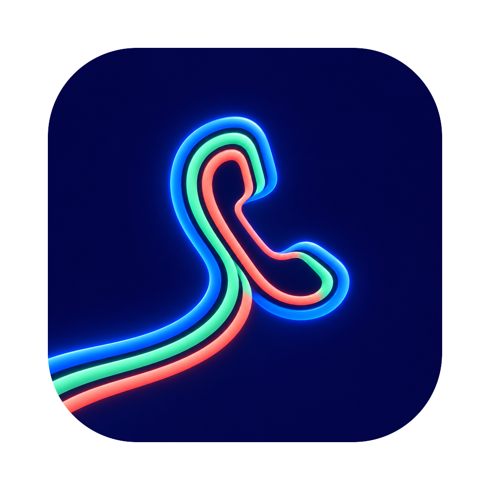

<p align="center">
  
</p>

<h1 align="center">Lines</h1>

<p align="center">
  A phone app for your <a href="https://voip.ms">VoIP.ms</a> numbers, on the Mac and the iPhone.<br>
  Texts, pictures, calls and voicemail, through a small server that you run yourself.
</p>

<p align="center">
  <a href="LICENSE">MIT license</a> ·
  <a href="#quick-start">Quick start</a> ·
  <a href="#how-it-works">How it works</a> ·
  <a href="#limits">Limits</a>
</p>

---

## What it does

| | |
|---|---|
| 💬 **Texts** | Send and get SMS and MMS, with pictures. |
| 📞 **Calls** | Make and take calls over WebRTC. Forward calls to your cell when you are away. |
| 📼 **Voicemail** | Play each message at once, read the transcript, mark it read, delete it. |
| 🔢 **Many numbers** | Each number is a "line". Tap the number at the top to change the line, and give each line a name. |
| 🔔 **Push** | Optional: the iPhone gets a notification for each text and each call. |
| 👤 **Contacts** | The lists show the names from your contacts. |

Lines is not affiliated with VoIP.ms.

## What is in this repository

| Folder | What it is |
|---|---|
| `src/`, `src-tauri/` | **The app.** Tauri 2 with React. The calls use [JsSIP](https://jssip.net). |
| `server/` | **The server.** A small Django API and Asterisk, in one Docker Compose file. |

## How it works

VoIP.ms accepts API requests only from the IP addresses on its API page. So a phone cannot talk to VoIP.ms directly.
Your server holds the VoIP.ms keys, and the app talks only to your server.

```
                    ┌─────────── your server ───────────┐
  app ──── https ──▶│ Caddy ──▶ Django API              │──▶ VoIP.ms API
  app ──── wss ────▶│ Caddy ──▶ Asterisk                │──▶ VoIP.ms SIP
  VoIP.ms ─ hook ──▶│ Caddy ──▶ Django (new text)       │
                    └───────────────────────────────────┘
```

- **Texts:** the server copies your texts into its database. The app reads that copy every 8 seconds. VoIP.ms calls
  the text hook of the server when a new text arrives.
- **Calls:** the app signs in to Asterisk. A call goes out from the selected line. A call that comes in rings every
  open app.
- **Voicemail:** the server reads your voicemail box, and keeps the audio of each message so it plays at once.

## Quick start

You need three things:

- ☎️ A **VoIP.ms account** with one or more numbers in the US or Canada.
- 🖥️ A **Linux server** with a fixed public IP address, Docker, and a domain name such as `phone.example.com`.
- 💻 A **Mac** with [Bun](https://bun.sh), [Rust](https://rustup.rs) and Xcode. The Mac app needs macOS 26 or later.
  The iPhone app needs iOS 17 or later.

Then do the three steps below, in this order.

### Step 1: Set up VoIP.ms

<details>
<summary>Open the steps for the VoIP.ms portal</summary>

1. Open **Main Menu > SOAP and REST/JSON API**. Enable the API, set an API password, and add the IP address of your
   server.
2. Make a voicemail box (**Voicemail > Add Voicemail**). Write down its number.
3. Make a sub-account (**Sub Accounts > Create Sub Account**) with a user name and a password. Turn off international
   calls on it.
4. Do these steps for each number (**DID Numbers > Manage DIDs**):
   - Set the routing to the sub-account.
   - Set the point of presence to the server that you put in `VOIPMS_SERVER`, such as `toronto1.voip.ms`.
   - Set the voicemail box. Set the failovers (busy, unreachable, no answer) to the same box.
   - Enable SMS and MMS. Set the SMS URL callback to the address below, and enable the retry:

     ```
     https://phone.example.com/voipms/text/<PHONE_HOOK_TOKEN>?from={FROM}&to={TO}&message={MESSAGE}
     ```

</details>

### Step 2: Start the server

```sh
git clone https://github.com/vladartym/lines && cd lines/server
cp .env.example .env        # then fill in each value
docker compose up -d --build
```

<details>
<summary>Open the details: DNS, firewall and the check</summary>

1. Point the DNS A record of your domain at the server, before you start it. Caddy gets the HTTPS certificate by
   itself.
2. Open these ports in the firewall of the server:

   | Port | From | For |
   |---|---|---|
   | TCP 80, 443 | all addresses | HTTPS |
   | UDP 10000-10099 | all addresses | The audio of the calls |
   | UDP 5160 | the VoIP.ms server only | SIP |

3. In `.env`, make each secret with `openssl rand -hex 32`. Each value has a comment in `.env.example`.
4. Check that Asterisk signed in to VoIP.ms. The line must say `Registered`:

   ```sh
   docker compose exec asterisk asterisk -rx "pjsip show registrations"
   ```

The server keeps its data in one SQLite file, in the Docker volume `data`.

</details>

### Step 3: Build the app

```sh
cd lines
bun install
cp .env.example .env        # set VITE_SERVER_URL and VITE_SERVER_KEY
bun run install-app         # the Mac app, to ~/Applications/Lines.app
```

> [!WARNING]
> The build contains your API key. Anyone with your build can read your texts and make calls. Never share your build.
> To stop a key, change `LINES_API_KEY` on the server and build the app again.

<details>
<summary>Open the details: settings, the iPhone and signing</summary>

**Settings in `.env`**

| Name | Value |
|---|---|
| `VITE_SERVER_URL` | The address of your server, such as `https://phone.example.com`. |
| `VITE_SERVER_KEY` | The same value as `LINES_API_KEY` in `server/.env`. |
| `IPHONE`, `SIM` | Optional: the iPhone and the simulator for the commands below. |
| `MAC_SIGNING_IDENTITY` | Optional: a signing certificate for the Mac app. |

**Your own bundle ID and team ID.** Search the repository for `com.vladartym.lines` and `C5338FSGXJ`. Replace each
with a bundle ID of your own and your Apple team ID.

**Other build commands**

```sh
bun run install-ios   # the iPhone on the cable or on Wi-Fi (debug build)
bun run sim           # the iOS simulator
bun run dev           # the page in a browser, at http://localhost:1420
```

In a browser, the native parts (contacts, tab bar) are not there.

**Signing on the Mac.** The first call asks for the microphone, and the first start asks for the contacts. macOS keeps
these answers for the signature of the app. An ad hoc build is a new app at each build, so it asks again. To stop
this, set `MAC_SIGNING_IDENTITY` to a certificate of your keychain (`security find-identity -v -p codesigning`).

</details>

<details>
<summary>Optional: push to the iPhone</summary>

1. Make an APNs auth key in your Apple developer account.
2. Put the key, its ID, your team ID and the bundle ID of the app in `server/.env` (`APNS_*`). Restart the server.
3. The iPhone build needs a profile with push. `scripts/xcodebuild` gives Xcode the App Store Connect API key of
   `.env` (`APPLE_API_*`), so Xcode can make the profile with no Apple account signed in.

</details>

## Calls to your numbers

| Setting | What happens when a call comes in |
|---|---|
| **Forwarding on** (Settings > Forward to my phone) | Your cell rings as a regular call, and every open app rings with it. With no answer in 20 seconds, VoIP.ms sends the caller to voicemail. |
| **Forwarding off** | The iPhone gets a push. Asterisk waits 20 seconds for an app to open, then rings every open app for 30 seconds. |

With forwarding on, the cell shows the number that the caller called, not the number of the caller. VoIP.ms refuses a
caller ID that is not one of your numbers.

## Limits

- Lines has no CallKit. With forwarding off, a call rings only while the app is open.
- The calls go to numbers in the US and Canada only, and to `4443`, the echo test of VoIP.ms.
- On the iPhone, a call continues when the phone locks, if the call started with the app open.
- VoIP.ms cannot mark a voicemail message as read, and deletes only the last message of a folder. The server keeps the
  read marks itself, and hides a deleted message until VoIP.ms can delete it.

## For developers

<details>
<summary>Open the map of the code</summary>

| Path | What it does |
|---|---|
| `src/api.ts` | The calls to the API of the server. |
| `src/phone.ts` | The calls: JsSIP over the websocket of the server. |
| `src/store.ts` | The lists that the device keeps, so they show at once at the start. |
| `src-tauri/contacts.m` | The contacts of the Mac and the iPhone. |
| `src-tauri/mac/`, `src-tauri/gen/apple/Sources/lines/` | The native tab bar in Liquid Glass. |
| `server/phone/` | The API, the texts, the calls, the voicemail and the push. |
| `server/asterisk/` | The Asterisk configs. |
| `server/Caddyfile` | HTTPS, and the check of the key before the websocket opens. |

</details>

Run the server tests:

```sh
cd server
uv venv && uv pip install -r requirements.txt
DJANGO_DEBUG=1 .venv/bin/python manage.py test phone
```

## License

MIT. See [`LICENSE`](LICENSE).
